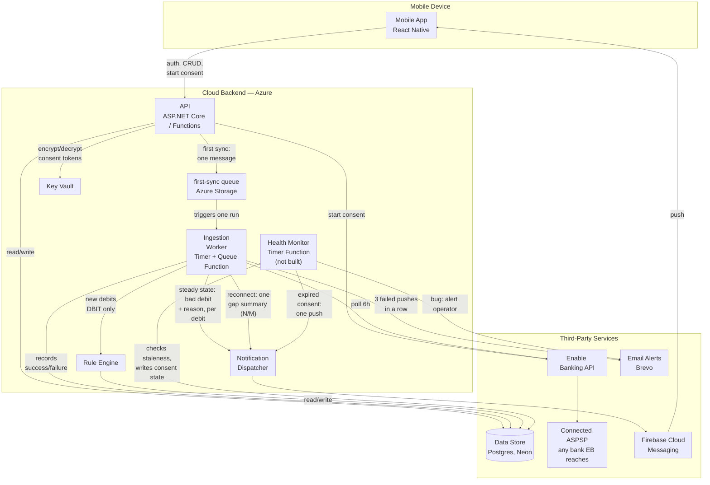
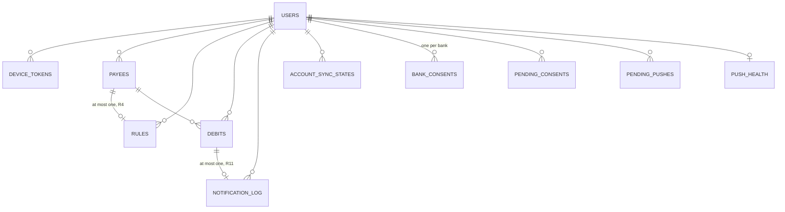

# Architecture

Status: **built and running** (Tracer 3 closed 2026-10-19): the backend runs on Azure for the owner, with N26 and DKB
connected. Written after the mocks settled, **reconciled with `REQUIREMENTS.md` on 2026-08-17** (all `A1`–`A10`
divergences are closed; see "Reconciliation with `REQUIREMENTS.md`") and **brought up to date with the
as-built system on 2026-10-19** (bead `gn-tn2`). Where a section says "not built", it is a design that is still open.
Names, commands and measured numbers of the Azure setup live in `TRACER-03-GO-LIVE.md`; this file holds the decisions.

## Component diagram

| Component | Tech | Execution place | Responsibility |
|---|---|---|---|
| Mobile App | React Native | Mobile device | UI (debit list/detail, rules, settings), receives push, in-app classification |
| API | ASP.NET Core / Azure Functions (HTTP), C# | Cloud backend | Auth, payee/rule CRUD, debit history, brokers Enable Banking consent flow |
| Ingestion Worker | Azure Functions (Timer + Queue), C# | Cloud backend | Walks every connected bank on a 6 h timer (one bank's failure does not stop the others); also run once, right after a consent is granted, by a queue message the API puts there (the one-time first-sync exception — see "Transaction ingestion"). No other on-demand trigger; records success/failure per bank. Drops credits (R2a). Runs in one of three modes — see "Ingestion modes" |
| Health Monitor | Azure Functions (Timer), C# | Cloud backend | Daily check for consents stuck failing 20h+, with an email to the operator. **Not built.** Its two halves exist elsewhere: the user-facing half of an expired consent (the one push, R19) is done by the Ingestion Worker on every tick, and the operator email for failing pushes is sent by the push-failure watch (see "Reliability"). What is missing is the staleness check and any alert for a failing tick (beads `gn-r1d`, `gn-7el`, `gn-emh`) |
| Rule Engine | C# | Cloud backend | Resolves payee → applies that payee's rule (R5) → returns each debit's good/bad result **with the reason** (R12a). Mode-agnostic: it classifies the same way regardless of which ingestion mode the tick is running — it does not decide whether or how anything gets sent |
| Notification Dispatcher | C# | Cloud backend | Sends via FCM. In the built code this is `INotificationSender` taking a plain `PushMessage(Token, Title, Body)`: the runner supplies R12a's reason text for one bad debit (Steady state) or R20's summary text with N/M counts (Reconnect, built by `ReconnectSummary`); the sender never decides which to send, only delivers what it's given |
| Key Vault | Azure Key Vault (RBAC) | Cloud backend | Holds every secret of the app: the API key, the consent encryption key, the database connection string, the Brevo key, the Enable Banking private key and the Firebase service account (six references in app settings; see "Authentication and secrets") |
| Data Store | Postgres on Neon (free tier, eu-central-1; it suspends after 5 min idle, see "Cost") | Third party | Users, BankConsents (encrypted, with the poll status per bank), PendingConsents, Payees, Rules, Debits, AccountSyncStates, NotificationLog, PendingPushes, PushHealth, DeviceTokens |
| Enable Banking API | PSD2/XS2A aggregator | Third party | Consent flow, transaction feed |
| Connected ASPSP | Any bank Enable Banking reaches | Third party | Source of truth for the account's transactions. N26 is the first one integrated, not a fixed dependency (R22) |
| Firebase Cloud Messaging | Push service | Third party | Push delivery to APNs + Android |
| Email Alerts | Brevo (free, 300/day forever, no card — verified 2026-09-28; SendGrid's free tier ended May 2025) | Third party | Notifies the operator after 3 failed push attempts in a row, and again when pushes work afterwards. Brevo's "Authorized IPs" blocking must stay off |

**Hosting, as built (decided 2026-10-01, running since 2026-10-09; names and numbers in `TRACER-03-GO-LIVE.md`,
"Azure deployment").** There is **one** host, `GreedyNose.Functions` (Azure Functions, isolated worker model;
in-process support ends 10 November 2026 and only isolated runs .NET 10). `GreedyNose.Api` is only a library of
endpoints, domain and data code. The host has:

- **the HTTP functions** of the API (same paths, no route prefix), with the API key checked by Functions middleware;
- **`IngestionTick`**, a timer trigger on the app setting `IngestionSchedule` (every 6 h, UTC). It runs one
  `IIngestionTick` and keeps no state between runs. `RunOnStartup = false` and `UseMonitor = false` on purpose: a
  cold start, a scale-out or a restart after downtime must not cost a bank fetch (N26 allows about 4 a day), so a
  missed run is skipped and the next scheduled one runs. A schedule shorter than 6 h is refused at startup unless
  `Ingestion:AllowShortInterval=true` (local tests only). One tick has a 120 s deadline; one bank's turn inside it
  40 s (`Ingestion:BankTimeout`), after which that bank records an error and the walk goes on;
- **`FirstSync`**, a queue trigger on the queue `first-sync` of the Functions storage account. The consent callback
  puts one message there (a fixed word, no secret, no IBAN, no session) and the function runs the same tick. It
  does not swallow a failure: three dequeues, then the message lands in `first-sync-poison` and the next scheduled
  tick does the same sync. Nothing watches that poison queue yet (bead `gn-a64`).

Both entry points run the same tick, `ConsentRestoringTick` wrapped in `SerializedTick`. The first reloads the
consents from the database before every tick (the database is the source of truth, so a bank connected or
reconnected is seen without a restart; a failing restore, e.g. a wrong key, skips the tick and is logged at Error with
the exception type only, which no alert picks up yet, bead `gn-emh`). The second lets one tick run at a time per
process, so the timer and the queue function cannot both find the same new debit; several instances at once are not
covered (bead `gn-w4l`).

The plan is **Flex Consumption** (Linux, Germany West Central), chosen because .NET 10 runs on Linux only there. It
is free at this scale (250,000 executions and 100,000 GB-s a month per subscription). Accepted cost: a cold start
of about 5 s on the first request after a quiet period (measured 4.6 s); pushes are not affected, they come from
the timer. Rejected: App Service F1 (60 CPU min/day, no Always On); Container Apps with one always-on replica
(~$1–3/month) stays as the fallback. The Functions storage account is reached through the app's own identity, with no
storage key in any setting. Migrations are never applied by the app (several instances can start): they run by hand
from the owner's machine before each deploy that needs one.

Logging follows the same privacy rule as everything else: **a log line never carries a session id, an account uid, an
IBAN, a payee or an amount.** The default HTTP-client logging is removed for every client; the one Enable Banking
client logs `Enable Banking {Method} {PathTemplate} -> {StatusCode}`, with every path segment outside a fixed
allowlist replaced by `{id}` (it fails closed). That line is also how the daily fetch count against a bank's quota and
a `429` are read from Application Insights.

## Data model — tables and relationships

Read from the real schema (`backend/GreedyNose.Api/Data/`, EF Core, 17 migrations as of
2026-10-16) — this reflects what's built, not just designed. Column-by-column detail stays in the
entity classes, which are the single source of truth; this is only the shape a caller can't safely
guess from one table's own columns.

| Table | Key | What it holds |
|---|---|---|
| Users | `Id` | Anchor for every other table's `UserId`. No auth fields — one seeded row, single-user (R22a); the API key authenticates the owner, see "Authentication and secrets" |
| DeviceTokens | `Id`, unique on `Token` | One FCM token per install; re-registering the same token upserts, never duplicates |
| Payees | `(UserId, Id)` | `Id` is R3a's resolved payee key, stored verbatim — not a generated id |
| Rules | `(UserId, PayeeId)` | The key **is** the composite FK to Payees — a payee has at most one rule by construction (R4), not by application logic |
| Debits | `(UserId, Id)`, indexed on `(UserId, AccountKey)` | `Id` is R10b's resolved debit identity (`entry_reference` or the composite fallback), stored verbatim. The `AccountKey` index backs the per-account dedup read in the ingestion tick — it is no longer the mode signal (see AccountSyncStates) |
| AccountSyncStates | `(UserId, AccountKey)` | One row per connected account, and it **exists only once that account's first sync has finished**: `FirstSyncCompletedAt` says when. A missing row means "first sync still to do" — the Ingestion Worker's mode signal (see "Ingestion modes"). The second field, nullable `LastSessionIdHash`, is the SHA-256 of the consent session the last completed tick used — a **hash, never the session id**, which reads the real account and so is not something to add to the database; equality is all the reconnect check needs. `null` means "written before this field existed" and is adopted silently. `AccountKey` is the IBAN, never the per-consent `uid`, so a reconnect finds its own row. Keyed per account, not per user, so several accounts per user need no re-keying later (v1 is one account per bank, R22a) |
| NotificationLog | `Id`, unique on `(UserId, DebitId)` | R11's guard **at the database level**: the unique index makes a second send fail on insert, not just on an application-level check-then-insert that could race |
| BankConsents | `(UserId, AspspName)` | The live consent of one bank — see below |
| PendingConsents | `Id` | A consent the owner is in the middle of starting: the bank, and the **SHA-256 hashes** of the one-time link token and of the OAuth `state` — the database never holds a value that can start or finish a consent. Each is consumed once; "single use" is made atomic by an app-managed `Version` (two requests with the same secret both read version N, one UPDATE wins). A hard deadline of 30 minutes from creation. Decided 2026-10-21, not built yet: for a bank with several accounts the row also holds the session id and the account list, encrypted, with a shorter deadline from the callback |
| PendingPushes | `Id`, unique on the debit | R11a's **push owed** mark: written in the same save as the debit it belongs to when the first send fails, retried every tick for 24 h, then ended `Sent` or `GaveUp` (kept for diagnosis). Holds the reason text frozen at creation (or N and M for a reconnect summary), the attempts and the last outcome name. Never inferred from "bad debit without a NotificationLog row" |
| PushHealth | `UserId` | One row per user behind the operator mail: failed push attempts in a row, where the incident stands (first/last failure, mail sent, recovery mail owed). Outcome names only — nothing about payees, amounts or tokens |

**Every table but Users is keyed with a composite `(UserId, …)`**, not a bare id — deliberate, so a
real multi-user login later needs no re-keying (R22a's single-user scope is a v1 limit, not a
schema one).

**Delete behavior is asymmetric on purpose, and it's the one thing worth knowing before touching
any of this:** `UserId → Users` cascades (removing a user must empty every table; deleting a bank, R18, is a narrower delete, see "Data lifecycle"). Every
other cross-table FK — Rule→Payee, Debit→Payee, NotificationLog→Debit — is `NoAction`, refusing a
lone parent delete instead of silently taking its children along. Two consequences that aren't
obvious from either table alone: a payee "upsert" written as delete-and-reinsert would silently
wipe the user's rule if this weren't enforced, and deleting a debit could otherwise erase its
`NotificationLog` row — which would make the next fetch see that debit as new and re-notify,
breaking R11.

**`BankConsents` holds the live consent of each bank (built 2026-10-07, Story 1.7; walked per bank since Story
3.2).** One row per `(UserId, AspspName)`: reconnecting a bank **replaces** its row and never touches another
bank's. The session id and the rest of the consent (accounts, connected-at, expiry) are **AES-256-GCM** ciphertext
(`ConsentCipher`; row and column bound as associated data; key = `Consent:EncryptionKey`, base64 of 32 bytes, from
user secrets locally and Key Vault in Azure). Elsewhere in the database the session appears only as a hash, and it
is never logged. The backend refuses to start without the key and stops if a stored consent cannot be decrypted
(wrong key) — never a silently empty store. Rotating the key means re-consent: a row carries a version byte but no key
id, so a new key cannot read old rows.

The plaintext columns carry no account data, only what the worker and `GET /status` need: `UpdatedAt`, the **poll
bookkeeping** (`LastAttemptAt`, `LastSuccessAt`, a short `LastError` made of an exception type and a code, never a
message; `PollIntervalMinutes`, null = 6 h) and `ExpiryNotifiedSessionHash` (who was already told the session died, see
"Consent lifecycle"). The worker writes the bookkeeping after each bank; a reconnect leaves it alone. A repeat
`/connect` for a bank that already has a consent replaces it, and then the old session is closed with
`DELETE /sessions/{id}` (5 s, best effort; "already closed" counts as fine; checked at DKB: the new session keeps
fetching). Nothing stops a second consent from being *started* for a bank that has an active one (bead `gn-4b3`).

The Ingestion Worker takes the user from each consent row, not from the hardcoded `SeedData.UserId`; new code adds no
new `SeedData.UserId`.

## Client

**React Native.** Considered .NET MAUI and Flutter.

- Mocks in `mocks/` are Flexbox HTML/CSS by deliberate choice, so they map closely to RN
  components.
- Given the intent to commercialize later, RN's ecosystem (subscription/monetization SDKs
  like RevenueCat, analytics, A/B testing) and larger hiring pool tipped the decision over
  Flutter. Flutter's main edge (pixel-consistent rendering, smoother animation) matters less
  for this app's plain list/card/settings UI.
- MAUI was attractive given existing C# experience, but was dropped due to a thinner
  ecosystem for the two riskiest integrations (bank consent webview flow, push
  notifications).

**Push on Android (decided 2026-10-01, built in Story 2.2).** The default FCM channel shows no heads-up and a generic
icon, and the alert is the whole product. So the app creates its own high-importance notification channel `alerts`
(`MainApplication.kt`) and ships a monochrome small icon `ic_stat_alert`; the backend names both in the Android part of
every push (`FirebaseNotificationSender`, `AndroidChannelId`). The three places must stay in sync, and the manifest
says so. What the target phone does when the app is force-stopped is still unmeasured (open in `TRACER-03-GO-LIVE.md`).

## Backend

Separate service from the client — its language doesn't need to match RN. **ASP.NET Core /
Azure Functions (C#)**, leveraging existing team experience for the reliability-critical half
of the system.

Components:

- **API** — auth, payee/rule CRUD, debit history for the app's list/detail screens, and
  brokering the Enable Banking consent flow (session start + redirect callback, encrypted
  token storage).
- **Ingestion worker** — see below.
- **Rule engine** — see below.
- **Notification dispatch** — Firebase Cloud Messaging (unified path to APNs + Android).
- **Data store** — Users, BankConsents (encrypted), Payees, Rules, Debits (cache), and a
  light NotificationLog.

### Rule engine

The Rule Engine never resolves a payee or decides what's new — that happens upstream, in the
Ingestion Worker's pipeline (see "Debit identity" for the exact order). By the time a debit reaches
the Rule Engine, its payee is already resolved and it's already been identified as new and booked.
The Rule Engine's whole job is: read that payee's rule, apply R5 exactly as the spec states it, and
return the result to its caller (the Ingestion Worker) — it does not call the Notification
Dispatcher itself; see "Ingestion modes" for who does and when:

| Rule for the payee | Result | Reason returned |
|---|---|---|
| No rule | **bad** | `NoRule` |
| Bad | **bad** — the amount is **not** consulted | `MarkedBad` |
| Good, no amount | **good** | — |
| Good, amount set, debit ≤ amount | **good** | — |
| Good, amount set, debit > amount | **bad** | `OverLimit` (carries the limit) |

Two details are easy to get backwards and both break R1 if they are:

- **The amount belongs to the *good* branch only.** A bad payee alerts on every charge, whatever
  its size. Evaluating a leftover limit for a bad payee would silence exactly the payees the user
  flagged on purpose. (This was `A1`, and it was written the wrong way round here until
  2026-08-17.)
- **Equality is good** (R5a): a charge exactly equal to the limit does not exceed it, so `>`,
  never `>=`.

The comparison uses the **booked amount in the account currency** (R16) — what actually left the
account. If the bank also reports an original foreign amount, it is passed through for display on
the debit detail screen and never enters the comparison. There is no currency conversion anywhere
in the backend.

The engine does not word the notification; it hands over the reason and lets the dispatcher
render R12a's title and body. Keeping the wording in one place means the three bodies ("You
haven't reviewed this payee yet", "You marked this payee as bad", "Over your limit of «limit»")
cannot drift from the reasons that produce them. The first body deliberately avoids claiming the
payee is unfamiliar — `NoRule` also covers a payee the user chose not to review during onboarding
(R26a), who has visible history in the user's own Debits list.

### Classification is derived, never stored

Good/bad is **computed at read time** from the payee's current rule (R6) and never written onto
the debit record. R7 requires a rule edit to re-label that payee's existing debits immediately;
derived classification gets that for free, whereas a stored flag would need a re-labelling job
over history on every rule edit — more moving parts, and wrong in the window before it finishes.

The one thing that *is* persisted is **whether a debit has been seen before** (R10b) and whether
a notification was sent for it (NotificationLog). That is what keeps R10a honest: a debit that
turns bad later because the user edited a rule is re-labelled in the list on the next read, but
it is not new, so nothing notifies.

## Payee identity

Two different matching problems live in this system and they must not share a key:

| | Question | Key |
|---|---|---|
| **Payee identity** | "Is this the same party as last time?" | best-effort, this section |
| **De-duplication** | "Have I already seen this exact charge?" | `(account, entry_reference)`, see "Debit identity" |

**The exact key R3a wanted does not exist.** Enable Banking's support confirmed on 2026-08-17
that their transaction model carries no SEPA creditor identifier and no mandate ID, and they
could not point to a passthrough or roadmap item that would expose one — even though N26's own
PSD2 interface publishes both. `A6` is therefore designed around its absence rather than waiting
for it.

The key is two-tier, matching their own recommendation:

1. **Normalized creditor account identification** — the IBAN, where the charge carries one.
2. **Normalized name** (uppercase, strip digits and extra whitespace), plus the **creditor agent**
   (the creditor's own bank, typically by BIC, as reported — inconsistently — by the ASPSP)
   where it separates two payees that would otherwise collide.

`reference_number` is explicitly not usable here: it is intended for credit-transfer references.

Consequences for the design:

- **Store every raw string ever seen for a payee**, alongside the resolved key (R3a) — specifically
  a **distinct set** (not a full occurrence log with duplicates/timestamps) of each of the three
  fields the key itself is built from: creditor account/IBAN, normalized name, and creditor
  agent/BIC. This is not bookkeeping — it is the only way to re-tune matching later against what
  banks actually sent, instead of guessing, and keeping exactly the fields the key uses is what
  that re-tuning pass needs. See "Refining these from real data".
- **When matching is uncertain, split rather than merge** (R3b). A split shows a known payee as
  unknown → a false alert: annoying but safe. A merge lets an unknown payee inherit "good" → a
  missed alert, which breaks R1. With a fuzzy key, ambiguity is the normal case, so this rule
  runs often.
- Matching degrades per-bank rather than failing (R22): the creditor account is missing for some
  ASPSPs and some charge types, and tier 2 has to carry those alone.
- Direct debits get the weakest matching, which is the product's most important charge type.
  Accepted, not solved.

## What counts as a debit

Enable Banking returns both directions of money. R2a says incoming money is ignored **entirely**:
never listed, never notifies, never creates a payee. The filter lives in the ingestion worker, at
the earliest possible point — before payee resolution, so a credit cannot bring a payee into
existence.

The field is `credit_debit_indicator`, whose only values are `CRDT` and `DBIT`; **keep `DBIT`**.
Without this, the user's first salary payment creates a payee with no rule, which classifies bad
(R5) and fires a notification.

**This is an allowlist, not a `CRDT` denylist** (verified against `TransactionMapper.cs`, step 7
findings): a row proceeds only when the indicator is exactly `DBIT`. A missing, null, or any
future unrecognized third value is dropped along with `CRDT` — never lets an unexpected value
through by default.

Accepted side effect, straight from R2a: a refund from a bad payee is invisible in the app.

## Transaction ingestion: polling, not webhooks

Verified against Enable Banking's docs: webhooks only exist for **payment status** (PIS,
outgoing payments initiated through them), not for account information / new transactions.
There is no push mechanism for "a new transaction appeared" — it must be polled via
`GET /accounts/{account_id}/transactions`.

The binding constraint is on the bank side, not Enable Banking's own limits: most ASPSPs cap
**background** data fetches — i.e. when the end user isn't actively in the app — at **4 times
per day**, backing off 6 hours on `ASPSP_RATE_LIMIT_EXCEEDED`.

**That cap is per-ASPSP and will differ between banks** (R22). The 6h cadence below is a safe
default, not a constant: the poll interval is a configuration value held per ASPSP, so a
stricter bank can be slowed down without touching the worker. `ASPSP_RATE_LIMIT_EXCEEDED` is
handled as a
normal backoff signal for any bank rather than treated as a bug.

Given the product owner's call that same-day notification is an acceptable user experience
(not instant), the design is:

- A timer-triggered poll every **6 hours** (4x/day) per active consent — sits exactly at the
  ASPSP background limit with no rate-limit risk, worst-case latency ~6h. This is now the
  **only** repeating trigger — see below.
- **No repeating app-open fetch.** A PSU-headers "active session" exemption from the 4x/day cap
  was the original assumption (Enable Banking's docs implied it), but it's now **disproven**: a
  real device test against real N26 (2026-09-28) called the actual on-demand code path with PSU
  headers and still hit `ASPSP_RATE_LIMIT_EXCEEDED`. Repeating on-demand fetches would silently
  eat the same 4x/day budget as the timer poll — closes the open question below. The app now only
  ever reads whatever the backend already has; it cannot trigger a fresh Enable Banking call.
- **One narrow exception: the first sync (R25).** Right after the account is chosen, the **API** puts one message in
  the first-sync queue and the Ingestion Worker's pipeline runs **once, immediately** — the fetch logic itself still
  lives in exactly one place (the Ingestion Worker), never duplicated into the API. This is deliberately not "the app
  is open" in general — it fires once per connection, tied to the user's own just-completed consent action, not a
  repeating background signal — so it's a different case from the disproven exemption above, not a re-opening of it.
  Without this exception, onboarding's "mark your payees" screen (R26) would have to wait up to 6h after consent for
  any data to review.
- **The same exception on request (decided 2026-10-21, not built yet).** "Try again" on a bank whose first sync failed
  (R25, R36) puts the same message in the queue again, through one backend call per bank. It is the only way the user
  starts a fetch, and it is refused while the bank's daily fetch cap is used up (R29), so the user is told to try
  tomorrow instead of spending a call that fails. The sync state the app shows (syncing, failed, done) is read from
  the bank's existing fields (no `AccountSyncStates` row yet, the last attempt and its error); the exact derivation is
  decided in the story.

**The first sync pulls a fixed window of the last 90 days** (R25, changed 2026-10-09 from 12 months: real N26
answered 422 `WRONG_TRANSACTIONS_PERIOD` to a 12-month `date_from`): the
fetcher sends `date_from`, follows `continuation_key` to the last page, and returns the complete
window or throws — never a silent partial page. The fallback debit id's ordinal must not collide
across pages. To verify while building: whether each page counts against the bank's ~4 fetches
per day.

**The debit list is served from the database** (settled 2026-10-01): `GET /debits` reads stored
debits and payees and never calls the bank; the worker is the only thing that fetches. The list
is therefore up to one poll interval (6 h) old, and pull-to-refresh only re-reads it.

**Swipe-to-refresh needs no new backend contract.** With app-open fetch gone, a manual refresh in
the debit list is just the app **re-calling the existing debit-history read from the API** — the
same call it already makes to populate the list — never a fresh Enable Banking fetch. Whether
anything's actually new is a **client-side comparison** (did the response differ from what's
already shown?), not a backend flag or a second endpoint: if nothing changed, the app shows the
generic "up to date, checking again later" message locally; if it did, it just renders the new
list like any other load. No `LastSuccessAt`-style freshness field needs exposing to the client —
the existing per-consent poll tracking (see "Reliability: poll health monitoring") stays purely a
backend/Health Monitor concern.

## Ingestion modes

The worker has **three** modes, all sharing one fetch path. They differ only in what happens to
the debits that come back — which matters because R10b makes "new" mean "an unseen bank
identifier" (see "Debit identity"), so anything the app has never pulled before would otherwise
notify.

| Mode | When | What happens to the debits |
|---|---|---|
| **First run** | The account has no `AccountSyncStates` row yet, i.e. `FirstSyncCompletedAt` is unset | Full available history, stored as **already seen** — never to the Rule Engine. No notifications (R10b). The onboarding list (`01c-classify-payees.html`, R26) is read from these debits afterwards. All debits and the `AccountSyncStates` row are committed in **one** write, so the flag exists only if the whole pull was stored |
| **Steady state** | `FirstSyncCompletedAt` is set, and the poll follows the normal cadence | Incremental diff → Rule Engine → one push per bad **booked** debit (R10, R11, R10c) |
| **Reconnect** | The account's row exists, but the current consent session's hash differs from `LastSessionIdHash` — the user authorized again (an expired consent re-authorized, R36 reconnect). A gap while the *same* session stays valid (e.g. a backend outage) is deliberately not this mode: it is Steady state, one late push per bad debit. Verified 2026-09-29: every authorization returns a new `session_id` (UUID4, Enable Banking docs), and two sandbox re-authorizations of one IBAN gave a new session id **and** a new account `uid`. The hash is updated only after a tick fully completes, so a tick that dies midway is detected as a Reconnect again | Everything from the gap goes through the Rule Engine, but the dispatcher sends **one summary push**: "12 new charges while you were disconnected, 3 bad" (R20), suppressed entirely when the gap has zero bad debits (R20a) |

**The Reconnect summary is owned by the Ingestion Worker, not the Rule Engine or the Dispatcher.**
The Rule Engine stays mode-agnostic — it classifies every debit in the gap exactly as it would in
Steady state, one at a time, and returns each result to its caller. It is the **Ingestion Worker**
that knows the current tick is a Reconnect: it collects the Rule Engine's results for the whole
gap, counts N (total new debits) and M (bad ones), and makes **one** call to the Notification
Dispatcher only **if M > 0** — with a distinct "gap summary" request (N/M counts, R20's own
title/body) rather than the per-debit "reason" shape Steady state uses. If M = 0 it makes no call
at all (R20a). **The Rule Engine never calls the Dispatcher, in any mode** — it only ever returns
a result to its caller. The Ingestion Worker is what calls the Dispatcher, immediately and
per-debit in Steady state, batched into one call in Reconnect.

**The mode signal is `FirstSyncCompletedAt`, never "do any debit rows exist."** R25 requires that an
interrupted first sync is still the same first sync — a row-existence check gets this wrong the
moment the first sync has saved *some* debits and is then interrupted: the next tick would see rows
already present and misread itself as a reconnect gap, firing a spurious summary push over the
user's own history. It also gets a legitimately empty account wrong: no debits means no rows, so
the account would stay "first sync" forever and swallow its first real charge silently.

**The first sync is all-or-nothing, with no resume logic.** The worker fetches the complete history
and then writes every new debit plus the `AccountSyncStates` row in a single database write. If
anything fails before that write (the fetch, a timeout, a shutdown), nothing is stored and the next
tick simply starts the first sync again — safe to repeat because debits already stored are skipped
by R10b's dedup key. The cost is one more fetch against the bank's daily quota after an interrupted
first sync, which is a rare, single-user event. Consequence for the fetcher: it must return the
**complete** history or throw, never a silent partial page (pagination is on, `continuation_key`).

Reconnect is the mode that did not exist before 2026-08-17 (`A8`). Without it, a user coming back
after two weeks gets one push per bad charge in a single burst — R20 exists precisely to prevent
that, and it is a deliberate exception to R11. Normal per-charge alerts resume with the next
steady-state poll.

The alternative shapes were rejected for the same reason each time: a separate "Initial Sync"
component would duplicate the Enable Banking fetch logic, and suppressing the burst in the
dispatcher (rather than making the mode explicit) would hide a rule the spec states outright. The
cost is a worker with three modes to keep straight, which is worth an explicit test each.

**"First run" above is built, except for its onboarding routing (updated 2026-09-29).** The mode
signal is now the real `AccountSyncStates` row described above; the earlier stand-in — "do any
`Debits` rows exist?" — is gone, and with it the gap it had against an interrupted first sync
(a migration backfills a row for every account that already had debits, so an existing database
does not re-run its first sync). What is still not true is the table's "routed to the onboarding
classify screen": the first sync inserts everything as already seen with no rule evaluation and no
notification — matching R10b's consequence — but is silent, with no UI, because the classify
screen is not built yet (R26, `TRACER-02-NOTIFICATIONS.md`, "Deliberately out of scope"). The
Reconnect mode is built (2026-09-29): the runner derives it from the session hash, classifies each
new debit **without** sending, counts N (all new) and M (bad), sends **one** R20 summary push if
M > 0 — **before** saving — and then commits every new debit, any token prune and the new session
hash in **one** write. Sending first is deliberate: a tick that dies between send and save leaves
nothing stored and the hash old, so the retry finds the same debits and counts the same N/M — worst
case one duplicate summary, never a lost one and never a wrong count. A failed send (`Rejected`/
`Transient`) or a missing device token still commits (owner's decision, 2026-09-29); since 2026-10-01 the
summary is then **not lost**: it is retried from a push-owed mark like a debit push, with N and M frozen (R11a, see
"Reliability"). There are no `NotificationLog` rows for the summary — that log is per debit. A repeated debit id within one fetch is skipped and
counted once in every mode, since in the all-or-nothing modes one duplicate would otherwise fail the
whole tick on every retry. There is no separate Dispatcher class: the runner sends a `PushMessage`,
and the summary is that same message with R20's text (`ReconnectSummary`).

**Two concurrency risks a design like this table implies are already closed in the real
implementation**, not just designed around (`IngestionRunner.cs`, step 6 review findings): a tick
cut short after inserting some debits but before classifying them cannot strand an
already-committed, unclassified debit — one debit's insert and its classify/notify outcome commit
atomically, so a cutoff leaves it entirely uncommitted and it is retried next tick like one never
fetched (a regression test reproduces and proves this). And two debits in one batch resolving to
the same brand-new payee cannot poison the rest of that tick's writes — the payee-upsert race is
caught and the tracked entity cleared before continuing.

## Debit identity — never alert twice for one charge

Rewritten 2026-08-17, after Enable Banking's support answered. The previous design keyed debits
on "the bank-issued transaction ID" and assumed that ID survived a status change. **Both halves
were wrong**, and the correction is more consequential than the question that produced it.

**The canonical pipeline, owned entirely by the Ingestion Worker, in this exact order:** fetch →
keep `DBIT` only (see "What counts as a debit") → resolve the payee (R3a, "Payee identity") →
compute the de-dup key (`entry_reference`, or the composite fallback below, which needs the
already-resolved payee) → check the key against stored ones for novelty → only a debit that is
both new and booked is handed to the Rule Engine. Payee resolution runs *before* the novelty check,
never after or inside it — the composite fallback key cannot be built without it. Stated once,
here, rather than re-described (and re-risking contradiction) in "Rule engine" or "Ingestion
modes," which both point back to this paragraph.

**The key is `(connected account, entry_reference)`.** `entry_reference` is documented as unique
and immutable for the same account and matches across authentication sessions, but it is *not*
globally unique — hence the account scope, which the app has anyway (R22a: one account per bank,
several banks at once — every account has its own `AccountKey`).

**`transaction_id` must not be used for this.** It exists to fetch transaction details, is not
guaranteed to identify a transaction uniquely, and **may change between fetches** — a de-dup key
that changes under you is worse than no key, because the failure is a burst of duplicate alerts
for charges the user already saw.

**Only booked debits notify (R10c).** There is no identifier that reliably survives pending →
booked: for most ASPSPs `entry_reference` only exists once the charge is booked. So:

- Pending items may be shown in the list as provisional, and are excluded from identifier-based
  matching. **Replacing the provisional row once the same charge books is not yet designed** —
  REQUIREMENTS.md itself calls this "the intended rule, not a confirmed one," since no pending
  transaction has been observed on any account pulled so far. Left as an explicit open item here
  rather than silence: the match would need to be on account + amount + payee, date only
  best-effort (a pending report's date can shift once booked), and stays undesigned until a real
  pending transaction is observed to design it against.
- The Ingestion Worker's novelty check (see the pipeline above) fires the first time a key is seen
  **in booked state**, and does not re-fire on any later change — only that first sighting reaches
  the Rule Engine.
- Where an ASPSP demonstrably supplies an `entry_reference` that is already present while pending
  and unchanged at booking, that bank may alert earlier — a per-ASPSP capability, never an
  assumption (R22).

The cost is latency: an alert waits for the bank to book the charge, typically under a day, which
the "same-day notification is acceptable" decision already covers. The alternative doubles up on
every bank that re-keys at booking, and a false "you were charged twice" is worse than an alert a
few hours later.

This is R10b's real meaning, and it is why "new" is never a date comparison: banks deliver late,
and a charge booked three days ago still deserves its alert the first time the app sees it.

**When the key is unreliable, risk the duplicate, never the miss.** Some ASPSPs omit entry
references entirely, some hand out duplicates, and Enable Banking generates synthetic references
only under certain conditions. Where `entry_reference` itself cannot be trusted, the worker still
computes and uses the best available fallback — the composite key below — rather than abandon
matching altogether; "risk the duplicate" means that fallback can occasionally miscount, not that
the charge is unconditionally flagged new on every poll. Note the bias here is the *opposite*
direction from payee identity above, and for the same reason: there, merging two payees loses an
alert; here, merging two charges loses one.

### The composite fallback key

Used whenever `entry_reference` is missing — which, per real data, is most of the time (63 of 91
real debits). The key is `(account, day, amount, payee, ordinal)`, with every field pinned down:

- **`account`** — `ConnectedAccount.Key` (the IBAN), same scope as the primary key above.
- **`day`** — the booking date exactly as the ASPSP reports it, stored and compared as that raw
  string. No timezone conversion, no reinterpretation into the server's or user's local time. The
  client's own midnight-UTC grouping bug (see `CLAUDE.md`'s Known pitfalls) is exactly the mistake
  this avoids by never doing timezone math on it at all.
- **`amount`** — the booked amount in account currency (R16), same value the Rule Engine compares
  against a limit.
- **`payee`** — the **resolved payee key** (R3a's two-tier key, see "Payee identity" below), never
  the raw creditor-name string. Payee resolution already runs before this key is computed (see the
  pipeline above), so the resolved key is what's available — and it's also the more stable choice:
  the raw string can vary charge to charge for the same real payee, which would fragment one
  payee's charges across several composite keys.
- **`ordinal`** — a count of **already-stored** debits matching the other four fields, computed at
  write time (e.g. `COUNT(*) WHERE account, day, amount, payee match`, then this row is `count`).
  **Not** position within the current API response: the worker deliberately re-fetches overlapping
  windows on some polls (to catch late bank corrections), so response position for the same real
  charge can shift between polls even though nothing about the charge changed. A DB-count-based
  ordinal only grows monotonically per unique key, so it can't shift under a re-fetch. This also
  closes the previously-open question of whether the ASPSP's feed order is stable across polls
  (`TRACER-01-BANK-DATA.md`) — the key no longer depends on that at all.

## Reliability: poll health monitoring

The product's core promise — never miss a genuinely new bad charge — depends entirely on the
6h poll actually running for every bank every cycle. A silently failing poll would break that
promise without anyone noticing, so this gets explicit handling rather than being left to
chance. **What is built, and what is still only a design:**

1. **Built.** A failed fetch is *not* retried inside the tick — every fetch counts against the bank's ~4 a day, so a
   retry would spend the budget the next scheduled tick needs. The bank is tried again at its next poll. One bank's
   failure, or timeout, is isolated from the others.
2. **Built.** Every poll attempt of a bank — success or failure — is recorded on its `BankConsents` row
   (`LastAttemptAt`, `LastSuccessAt`, `LastError`). `GET /status` (API key) shows per bank the state (connected,
   expired, dead, first sync pending), valid-until, last success/attempt, a short sanitised last error and the number of
   debits still owed a push — never a session id, IBAN, amount or payee. `GET /health` is only liveness plus the worst
   real state. The poll interval per bank is a column (`PollIntervalMinutes`), skipping a bank polled within it.
3. **Built.** The user-facing half of a dead consent (R19): the Ingestion Worker pushes once per session as soon as
   it sees the consent dead, see "Consent lifecycle". No operator alert, and none is needed — the user can fix it.
4. **Built.** A failed push is retried and watched (R11a, below).
5. **Not built.** The separate daily **Health Monitor** job: it would look for any bank whose last successful poll is
   more than 20h old (a one-cycle buffer over the 6h cadence) and email the operator when the reason is not an
   expired or revoked consent. Today a tick that fails silently is found by reading `/status` or the logs — nothing
   alerts on it. Open beads: `gn-7el` (nothing monitors dispatch failure, only ingestion staleness), `gn-r1d` (its
   staleness query must exclude a bank the user deleted), `gn-emh` (a consent restore that fails every tick is
   only logged), `gn-a64` (nothing watches the first-sync poison queue). This keeps operator alerts limited to the
   failures that need a human, once built.

**A failed push is retried, not lost (R11a, decided 2026-10-01).** The per-debit path used to
commit a bad debit as seen even when its push failed (`Rejected`/`Transient`/no token), so the
alert was never retried. Now the debit is saved and listed, and carries an explicit **push owed**
mark (a `PendingPushes` row) set when the first send fails — never inferred from "bad and no `NotificationLog` row",
since a debit that turns bad through a rule edit has no row either and must not notify (R10a). Every
tick the worker, besides fetching, retries every marked debit from stored data (never calling the
bank) within a 60 s budget, for at most 24 h, then gives up and logs it; failed attempts are logged per debit. The
reconnect summary push (R20) is retried the same way, its counts N and M frozen at creation. Only
`TokenNoLongerValid` prunes a token; `Rejected` means a human must look.

**A push waits 72 h for a phone that is off, and says when the charge was booked (R11b, decided 2026-10-19).** The
FCM time-to-live is 72 hours (`FirebaseNotificationSender.TimeToLive`; it was 1 h and two alerts for a switched-off
phone were dropped). "Accepted by FCM" is still not "delivered" and no receipt exists. Because a push can arrive late,
the debit push body is R12a's reason plus `Booked 19 Oct.` (with `, 14:32 UTC` only when the bank gave a time;
`RuleEngine.WithBookingDate`). The suffix is added at send time from the stored debit, in the first send and in every
retry, so `PendingPushes.Reason` and `NotificationLog.Reason` keep the plain reason and the date is never frozen twice.
The reconnect summary (R20) is not a debit and carries no date.

**The operator mail** (Story 2.10, `PushFailureWatch`, state in `PushHealth`): a send to all of a user's tokens is one
attempt; after **three failed attempts in a row** one email goes to the owner through Brevo, once per incident. The
flag is set only after Brevo accepted the mail, so a failed mail is retried at the next evaluation. When a push works
again after a mail was sent, one follow-up mail says so; a success before any mail closes the incident silently. The
expiry push does not count as an attempt. The watch is an observer: it never throws into the tick and has its own time
budget and database context. It is the one slice of the Health Monitor that exists.

## Authentication and secrets (go-live, decided 2026-10-01)

**A single static API key**, sent by the app with every request, over HTTPS only (the Function App refuses plain
`http`). The key is checked by Functions middleware before any function runs; no endpoint is reachable without it
except the two browser pages, and `/raw` and `/aspsps` are removed (Story 1.3). The backend refuses to start without
`Api:Key` (at least 32 characters). `/connect` and `/callback` are browser pages that cannot send a header; each is
protected by its own one-time secret in `PendingConsents` (Story 1.4): the owner asks `POST /connect-links` (API key) for a
one-time link that works once and expires after 30 minutes, and the OAuth `state` is single use too. A failed or
interrupted attempt needs a new link. Owner-only for now. All endpoints get the user from **one "current user" seam**
(`ICurrentUser`, today it returns the owner), so a later move to per-user sign-in (OAuth/OIDC) touches that seam plus
the app's sign-in, not every endpoint; the schema is already keyed `(UserId, …)`. Before real multi-user, the payee key
still has to be scoped per user (bead `gn-2op`). Rotating the key: change it on the server and ship a new APK. The
static key sits inside the sideloaded release APK — accepted for one owner. Known weak spots, accepted for now: the
link token travels in a query string (`gn-76g`), `/connect` and `/callback` have no rate limit (`gn-rw1`).

**Secrets:** Key Vault (RBAC; the Function App's system identity has "Key Vault Secrets User") holds six values, which
app settings reference as Key Vault references: the API key, the consent encryption key (one session per user and bank),
the database connection string, the Brevo key, the Enable Banking private key (one per application, shared by all banks
and users) and the Firebase service account. Plain settings hold the rest (schedule, mail addresses, the Enable Banking
application id and redirect URL). The Functions storage account has no key at all: the app reaches it through its own
identity. Locally everything stays in `dotnet user-secrets`. Secrets are never committed, printed or logged.

**Azure access for the operator** is a service principal with the Contributor role on the one resource group only; Entra
security defaults (MFA for people) are on. How it is used is an operating matter — see `AGENTS.md`, "Cloud and release operations".

## Consent lifecycle

PSD2 access consents expire periodically (commonly ~90 days) and need re-authorization. This
needs its own check/notification path, independent of the transaction poller.

**Connecting a bank from the app (decided 2026-10-21, not built yet; replaces the browser flow of 2026-10-01).** The
backend holds the logic, the app asks and shows. Connecting and the first sync are two separate steps (R25):

1. **Search.** The app asks the backend for banks by name (`AspspResolver` reads Enable Banking's list). Each hit has
   name and country and a flag "already connected"; the backend also refuses a second consent for a bank that has an
   active one (`gn-4b3`).
2. **Consent.** The app asks `POST /connect-links` and opens the one-time URL in a browser (the system browser; a
   Chrome Custom Tab is tried in Story 5.7, not a WebView, which Enable Banking advises against). The callback arrives at
   the backend, which trades the code for the session. **The way back (Spike 5.1, measured 2026-10-21 on the owner's
   phone with DKB and N26, default browser DuckDuckGo):** nothing returns to Greedy Nose by itself. At DKB, Enable
   Banking asks for the login, then waits ("Waiting for completion"); the DKB app does not open by itself and the
   approval has to be found there by hand. At N26, an information page of Enable Banking comes first, then N26's own web
   login, then an approval message of the N26 app. In both cases the user goes back to the browser by hand. A tab of the
   browser can be lost when the user leaves it for another app (a password manager). Decision: **the callback page
   (after the code is traded) opens the app itself** with the link `greedynose://connected` (the app registers the
   scheme; no secret is in the link, the app reads the state from the backend with its API key). Tested: the page
   tries it on its own, DuckDuckGo asks once whether to open the app, and "yes" opens Greedy Nose; "no" leaves the page
   as it is. The page therefore also carries a visible button "Open Greedy Nose", and its text is neutral ("you can
   close this page"), because a second call of the callback with a spent code looks like a failure although the first
   one worked. The app does not rely on the page: whenever it comes to the foreground it reads the state of the
   attempt (Story 5.3) and offers "Try again". A verified App Link (no browser question) is a later option.

   **Research and chosen solution (Story 5.1a, 2026-10-21).** What established apps do: RFC 8252 ("OAuth 2.0 for
   Native Apps") says a native app must not use an embedded WebView for the sign-in but the system browser or a
   Chrome Custom Tab, and AppAuth for Android does exactly that and does not support a WebView at all (sources: the
   AppAuth-Android README; Android developer docs, "In-app browsing using Embedded Web"). The way back is a redirect
   to the app, by a custom scheme or, more safely, a verified App Link; a custom scheme can be claimed by another app,
   an App Link needs a file on a server we control and has no browser question. Other open-banking providers say the
   same (custom scheme or App Link as return; a custom scheme fails in a plain WebView; a provider may accept only
   https as redirect URL). **Decided 2026-10-22, measured on the owner's phone (Motorola, Android, DKB and N26, cloud
   backend):** a **Chrome Custom Tab** (`browserPackage` `com.android.chrome`; if Chrome is missing the default
   browser's Custom Tab, then the plain browser) and the neutral callback page that opens `greedynose://connected` with
   a visible button. The link carries no secret, so a foreign app claiming the scheme learns nothing; the state is
   read from the backend with the API key. The app keeps the running attempt (bank name, the bank's `validUntil` before
   the attempt, start time; never the link or any id) in AsyncStorage for 30 minutes, so a return after the app
   process died still ends in "connected". Without a `browserPackage` the library takes the user's default browser if it
   can do Custom Tabs (here DuckDuckGo), which is why Chrome has to be asked for by name.
   **What the measurements showed.** (1) The Custom Tab survives the round trips to a password manager and the bank's
   app (DuckDuckGo's did too); the page opens the app by itself in Chrome without a prompt (DuckDuckGo asks once).
   (2) The bank's app (DKB, N26) does not reliably bring the browser back by itself (the owner saw it return in some
   runs and not in others; in the one run recorded with start events the user switched back), so the waiting text
   tells the user to switch back. (3) The phone (Motorola, 30 % battery, little free memory) freezes background apps (`moto_freezer`) and the
   low-memory killer ended the Greedy Nose process while the user was in the bank's app, twice in four runs. (4) The
   new process, started by the link, crashed once with "Screen fragments should never be restored"
   (react-native-screens 4.27.0): `MainActivity` now installs `RNScreensFragmentFactory` before `super.onCreate`
   (the README's current way; checked on the device with `am kill` plus a start by the link, before and after).
   (5) The callback page is neutral for every outcome, so a replayed callback (N26 once) no longer looks like a failure.
   **Not confirmed:** whether Enable Banking accepts anything but https as redirect URL (the redirect URL registered
   with it stays the https callback of the backend, so the `greedynose://` hop is made by our own page and the
   question does not arise); a reason why the bank's app returns to the browser by itself in some runs and not in
   others (not found; the focus log cannot tell who brought the browser forward). These sources are partly vendor
   blogs and forum posts; the RFC text and the Android docs were not read in full.
3. **Account.** With one account the backend saves the bank at once. With several it keeps the session id and the
   account list **encrypted** (same key as `BankConsents`) on the pending consent, with a short deadline from the
   callback (set in the story), and the app fetches the list and sends the choice. The list holds a handle, the account
   name, the product and the last four IBAN digits — never the full IBAN, and none of it is logged. The choice is stored
   by **IBAN**, not by product text, so a bank renaming a product breaks nothing. Cancelling, or no answer before the
   deadline, closes the session at Enable Banking and saves nothing.
4. **First sync.** Saving the bank puts one message in the first-sync queue (see "Ingestion modes"); the app reads the
   bank's state and shows syncing, failed or done.

The rule-based `AccountSelector` (type `CACC` and product "Girokonto") is gone (Story 5.3): the user chooses. The
shell tool `tools/connect-bank.sh` is no second way any more and cannot finish a bank with several euro accounts. The
backend stays free of any bank name (R22).

**Built in the backend (Stories 5.2 and 5.3, 2026-10-22; the app side follows in Stories 5.6 to 5.9).** *Search:*
`GET /banks?q=` reads Enable Banking's list for the search only (about 10 minutes in memory, name and country only) and
marks the banks the owner has already connected; `POST /connect-links` refuses a bank whose consent is not expired
(409). *The attempt* is the `PendingConsent` row (its id is the attempt id, returned by `POST /connect-links`);
`GET /connect-attempts/{id}` answers `waiting`, `choose_account`, `saved`, `failed` (with a short reason) or `expired`
and nothing else. The callback sets the outcome: one account in euro is saved as before; several in euro wait
encrypted on the row (session id and account list, AES-GCM bound to row and column) for 15 minutes; none in euro (a
missing currency does not count) closes the session and fails with `no-supported-account`; an error, a cancel or a
failed trade fails with a code and never shows or logs the bank's text. A session that waits for a choice is closed at
Enable Banking before its payload is deleted: on a state read, on a new link and on each ingestion tick; a failed close
is retried (at most every 5 minutes per instance) until one day after the deadline. Known limit: the bank is compared
by name only (`gn-gbv`). *The choice* (Story 5.4): `GET /connect-attempts/{id}/accounts` lists the waiting accounts as
rows (a position as id, name, kind, the last four IBAN digits, and a "suggested" hint on the first current account);
`POST .../choice` saves the chosen account through the same code as the callback's one-account path; `POST .../cancel`
closes the waiting session. A choice first claims the attempt (Outcome saved, payload deleted, one writer wins by the
row's version) and only then stores the consent; if the store fails the new session is closed and the attempt reads
`failed`. Known residual: a process that dies between the claim and the store leaves a "saved" attempt without a
consent and an open session until the bank's own validity ends. *My banks* (Story 5.5): `GET /my-banks` lists the saved
banks (name, country, account name, valid-until, one state) from stored data only, never calling a bank; the states are
`expired` (also a dead and announced consent), `connected` (the account has its first-sync row), `syncing` and
`sync_failed` (the last attempt failed after the first sync was requested, with the reason `daily-limit`, `timeout` or
`bank-error`; or 30 minutes passed without a result, reason `not-finished`, which covers a queue message that was given
up). `POST /my-banks/first-sync` repeats a failed first sync (no new consent): it is refused unless the state is
`sync_failed`, and on the UTC day of a daily-limit failure (R29). `BankConsents` got `Country` (written when the bank is
saved; older rows stay null) and `FirstSyncRequestedAt` (written at saving and by the repeat; an EF concurrency token,
so two repeats cannot both queue a tick; timestamps are cut to whole microseconds because Postgres keeps no more).

**Built in the app (Stories 5.6 and 5.7, 2026-10-22).** *Settings and search:* `myBanksStore` reads `/my-banks` and
`/banks?q=`; the cards poll every 5 s only while a bank is syncing (the screen focused, stopped on blur and unmount); the
search waits 400 ms, needs 2 characters and drops stale answers; the Settings tab is a nested stack (`SettingsHome`,
`SelectBank`, `ConnectAttempt`). The first successful empty `/my-banks` answer of a process moves the user to Settings
once (the flag is spent only after the jump really happened); a failed read never claims "no bank". *Attempt:*
`connectStore` is built on the attempt id of the backend (the 5.1a baseline compare with `/status` is gone): start asks
`POST /connect-links`, opens the link in the Custom Tab, then reads `GET /connect-attempts/{id}` on the app link, on the
foreground, on the app start and every 4 s while the attempt screen is visible and the app active. One attempt runs at a
time; the running attempt (id, bank, country, start time; never the link) is kept in AsyncStorage for 30 minutes and
restored after a process kill. Cancel and going back while choosing or waiting post `/cancel`; a late answer after a
cancel is dropped by an attempt identity check. `backendCall` is the one request helper (API key, timeout, status
codes apart, no id or query in a log line). *First sync (Story 5.8):* a saved attempt hands over to the `Syncing`
screen (the stack is reset to `SettingsHome` + `Syncing`), which reads the bank's row of `/my-banks` every 4 s (matched by
name and country) until one read has succeeded since it opened, shows the state and stops waiting after 2 minutes (the
backend sync runs on). `Try again` (screen and Settings card) posts `/my-banks/first-sync` and flips the row to syncing
at once; it is not offered for the daily limit or an expired bank. When the sync is done the stack is reset and the debit
list opens; the offer of Story 5.9 goes between those two steps.

**A dead connection is never silent (R19).** No alerts arriving looks exactly like "nothing bad
happened" — the one failure mode that breaks R1 while appearing to work perfectly. So expiry
gets both channels:

- **A persistent in-app banner** over the debit list, per bank, for as long as the connection is expired
  (`01d-connection-expired.html`). The list stays visible underneath it.
- **One push**, when the consent expires by itself. This is the half that was ruled out here
  until 2026-08-17 (`A2`): the banner only reaches a user who opens the app, and a user who has
  not opened it in a week is exactly the one who needs telling. It is sent once per expiry, not
  per failed poll.

**Built 2026-09-29 (the push half; the banner is still the client's to build).** The Ingestion
Worker itself detects a dead consent on every tick — no separate Health Monitor is needed for the
user-facing case — and pushes `Bank connection expired` / `Reconnect to keep getting alerts.` once
per session:

- **Two signals.** (1) *Time*: `valid_until` reached (`ConsentStore.GetState(now)` returns
  `Expired`, evaluated at runtime, `>=`, falling back to `ConnectedAt + ConsentValidity`); the
  fetch is skipped entirely. (2) *The bank ended it early*: a fetch answers **401 with an `error`
  field**, **and** `GET /sessions/{id}` confirms a status other than `AUTHORIZED`. Only both
  together count. A 401 *without* `error` (our own bad signature), a 429, a 500, a timeout or a
  failed status check rethrow the original exception and never push, so a fault in our own
  credentials cannot produce a false "expired" alert.
- **Once per session, not per failure.** `BankConsents.ExpiryNotifiedSessionHash` holds the
  hash of the session the push was accepted for; the push fires only when it differs from the dead
  session's hash. A reconnect brings a new session hash, so a later death pushes again — nothing
  to reset. It is set **only if at least one token returned `Sent`**; `Rejected`/`Transient`, no
  device token, or only a stale token leave it empty and the next tick retries. That is
  deliberately different from the per-debit push (which commits anyway): here nothing sits behind
  the retry, the connection is dead and there are no debits to block. A stale token
  (`TokenNoLongerValid`) is pruned regardless. Send happens before the single save.
- **A consent that dies before the first sync finishes** is told the same way (Story 4.1): the guard lives on the
  `BankConsents` row, which exists from the moment of consent, not on `AccountSyncStates`, which exists only after
  the first sync. Both death signals work in first-sync mode.
- `ConsentStore.Restore` no longer drops an expired consent — it loads it as `Expired`, otherwise
  nobody would know after a restart which session died and the push would be lost.

**Verified in the Enable Banking sandbox, 2026-09-29** (a throwaway session created, closed with
`DELETE /sessions/{id}`, then read back — the original session was never touched):

| Case | Answer |
|---|---|
| Live session, `GET /sessions/{id}` | 200, `status=AUTHORIZED`, `access.valid_until`, also a `closed` field |
| **Our own bad signature** | 401, `code=401`, `message="Wrong signature"`, **no** `error` field |
| Fetch on a **closed** session | 401, `error=CLOSED_SESSION`, `message="Session is closed"` |
| Closed session, `GET /sessions/{id}` | 200, `status=CLOSED` (stays readable) |
| Old session after a **new** one is authorized | stays `AUTHORIZED` until `valid_until` |

`EXPIRED`/`REVOKED` were never observed (the natural 90-day expiry cannot be forced); the time
signal covers that case, and the status value is logged so the first real one can be learned. In
production a self-expiring consent is noticed at most one poll (6 h) after `valid_until`.

Re-authorizing puts the worker into **reconnect** mode, so the backlog arrives as R20's single
summary rather than a burst. Rules stay editable throughout (R21) — nothing in the API refuses
writes while a consent is dead.

## Data lifecycle

R18's table applies unchanged (see `REQUIREMENTS.md`) — the three ways a connection ends are
**not** the same operation underneath. Consequences for the backend:

- **Expiry keeps everything.** An expired consent stops polling but leaves Payees, Rules and Debits
  intact; re-authorizing resumes (Reconnect mode). There is no Disconnect any more (R18, 2026-10-19).
- **Deleting a bank (decided 2026-10-21, not built yet)** is a real delete of **that bank** only, not a soft-delete
  flag, and it is not undoable (`06c`). One backend call per bank does, in this order: revoke the session at Enable
  Banking (`DELETE /sessions/{id}`), then delete that bank's `BankConsents` row (and its encrypted tokens), its
  `AccountSyncStates`, its Debits, its `NotificationLog` rows and its `PendingPushes`. **Payees and Rules stay** (R3a,
  R18): they belong to the payee, not to a bank. **If the revoke at Enable Banking fails** (no answer, an error from the
  bank's side) the delete is **refused**: the bank and all its data stay and the user may try again (decided 2026-10-21,
  `gn-b0h`); a session that is already closed, expired or unknown there counts as done, as in Story 4.3. A tick or push in flight for that bank must not write after
  the delete (`gn-8j5`). Deleting the last bank leaves the device token and the rules; the app opens on Settings (R36).
- **Connecting a deleted bank again is deliberately routed to First run, never Reconnect (R20b).**
  A fresh consent finds `FirstSyncCompletedAt` unset (deletion removed the BankConsent and
  AccountSyncStates rows), so it satisfies "Ingestion modes"'s First run condition on its own —
  identical to a brand-new connection, with no gap for a Reconnect summary to diff against. Stated
  here so this reads as the deliberate consequence R20b requires, not an accident of the mode
  table's ordering.
- **Deleting the user** (`UserId → Users` cascades) is not a feature of the app; it exists so that a later multi-user
  version can remove an account without orphans.

## Bank-agnostic design

R22: any ASPSP Enable Banking reaches is a valid target. **N26 is the first bank integrated, not
a dependency** — nothing in the data model, rule logic or copy may assume it. v1 connects one
account per bank and several banks at once (R22a, changed 2026-09-29): the consent store holds one
consent per bank and the Ingestion Worker walks all of them, isolating a failure in one bank from the
others. Built and live with N26 and DKB (2026-10-13); ING-DiBa was dropped by the owner but nothing
prevents adding it. With several accounts *within* one bank (DKB returned five), the user chooses one in the app
and only that account is stored (see "Consent lifecycle"); until that is built, the account is chosen by rule (type
`CACC` and the exact product "Girokonto"; zero or several matches choose nothing and close the new session). **This currently
assumes a eurozone ASPSP** (R15 hard-assumes EUR); a non-EUR bank needs a currency model that
doesn't exist yet, and is out of scope until one does (see `CLAUDE.md`'s Open/deferred).
Known limit: a consent is stored under the bank's name only, not its country, so the "connected" mark of the bank
search and the refusal of a second consent treat one name in several countries as the same bank until the country is stored.

What this costs the design, concretely:

- The poll cadence is per-ASPSP configuration, because the background-fetch cap differs by bank
  (see "Transaction ingestion").
- Neither key can rely on fields only some ASPSPs populate: the creditor account is missing for
  some banks and charge types ("Payee identity"), and `entry_reference` is omitted or duplicated
  by others ("Debit identity"). Both degrade per-bank instead of failing.
- The consent flow is parameterized by ASPSP from the start. The bank-selection screen (`01-select-bank`) lists
  whatever Enable Banking offers, so no bank is named in the app or the backend.

## Cost

Enable Banking gives free "Restricted Production" access for accounts you personally link,
matching the project's zero-cost-to-start decision and its current single-user scope. That tier
is limited by *whose* accounts you link, not by which bank — so adding ING-DiBa or DKB alongside
N26 costs nothing extra (R22). Paid, volume-based pricing only becomes relevant once onboarding
other people's accounts at commercial scale — verified 2026-09-28: since April 2026 that pricing is
sales-quote only (no public price list at all, was previously "unpublished, contact-sales").

**Restricted Production is for the owner's own accounts only — verified 2026-09-29 against the
Terms of Service and the linked-accounts page.** The Terms exclude "accessing account information
that does not belong to the Control Panel user who associated the Linked Accounts with the
application", and forbid making the API accessible to third parties; technically the API returns
only accounts the Control Panel user linked through their own bank login and strips all others (an
empty list). So family members' accounts cannot be used on this tier; that needs a contract and the
company check (KYB) with Enable Banking. The owner's own several accounts are fine, but **each one
must be linked in the Control Panel** first. (Read from the pages via a summarizer — re-read the
Terms themselves before relying on this for anything beyond a personal deployment.)

On Azure: Functions (Flex Consumption), the storage account behind them, Key Vault and Application Insights are
all effectively free at this scale (a budget alert at 5 € a month guards it; the first Cost Analysis check is bead
`gn-euz`). Azure SQL serverless does auto-pause too, so "a real baseline cost even serverless" is a
softer claim than the doc originally made — the actual reason for moving to Postgres was avoiding
Azure SQL's ecosystem/tooling weight at this project's tiny scale, not an unavoidable cost Postgres
uniquely lacks.

**Postgres free tier — verified 2026-09-28, both idle-pause but neither risks data:** Supabase
pauses a free project after **7 days with no DB activity** (10–30s cold start on the next request
to un-pause); Neon suspends compute after just **5 minutes idle** (same cold-start behavior, no
pause action needed — it resumes automatically). Neither loses data, ever. In practice neither
matters here: the Ingestion Worker polls every 6h, touching
the DB far more often than Supabase's 7-day threshold; Neon, chosen, suspends after 5 minutes idle and resumes by itself (the connection retries cover the wait), so a deployed project stays awake on its own
without any keep-alive hack. Worst case either way is one slow request, never a missed alert.

**Decided 2026-10-01 for the go-live: Neon free tier**, with the EF migrations applied manually
from the owner's machine at deploy time (not at startup — a Function app can start several
instances). The redirect URL is the default `https://<name>.azurewebsites.net/callback`, no custom
domain, and it must be registered exactly in the Enable Banking *Production* application. The
consent's `valid_until` is the smaller of 90 days and the bank's `maximum_consent_validity`, read
fresh from `GET /aspsps` at every `/connect`.

**Email Alerts — the "zero cost" claim above didn't actually price this channel; now it does.**
Verified 2026-09-28: SendGrid's free tier ended in May 2025 (new signups get a 60-day trial, then
paid from $19.95/month) — using it as originally written would have silently started billing, and
worse, silently broken the operator's failure-alert channel (the one thing standing between a
broken poller and nobody noticing) if the bill ever lapsed. **Brevo** replaces it in the component
table above: 300 emails/day, free permanently, no card — comfortably enough for rare operator
alerts, and keeps the whole backend actually at zero cost, not just assumed to be.

## Accepted tradeoffs

- **First-sync cold start**: narrowed 2026-09-28 along with removing the repeating on-demand
  fetch (see "Transaction ingestion") — this tradeoff now applies only to the one remaining
  API-triggered immediate run, right after consent. It runs on Azure Functions' Flex Consumption plan,
  which can take a few seconds to wake up if idle (measured 4.6 s for the first request). Accepted
  as-is (no always-ready instance, to keep costs at zero) — the syncing screen's UI should be designed to
  feel intentional during this wait rather than stuck.

## Reconciliation with `REQUIREMENTS.md`

All ten divergences found on 2026-08-14 are folded into the text above:

| | What was wrong or missing | Where it now lives |
|---|---|---|
| `A1` | Rule engine evaluated the amount for **bad** payees | "Rule engine" — the amount applies to **good** payees only (R5) |
| `A2` | Consent-expiry push explicitly ruled out | "Consent lifecycle" — Health Monitor → dispatcher → FCM (R19) |
| `A3` | Frequency/count thresholds | removed everywhere; amount is the only threshold |
| `A4` | `debitor` / `Trusted`+`Bad` / `Transactions` | renamed to payee / good+bad / debits (R0) |
| `A5` | Nothing filtered incoming money | "What counts as a debit" — keep `DBIT` (R2a) |
| `A6` | Payee identity was one phrase | "Payee identity" — two-tier best-effort key (R3a) |
| `A7` | Derived-vs-stored classification unstated | "Classification is derived, never stored" (R6/R7) |
| `A8` | Reconnect-after-a-gap unhandled | "Ingestion modes" — the third mode (R20) |
| `A9` | No data lifecycle for R18 | "Data lifecycle" |
| `A10` | N26 treated as *the* bank | "Bank-agnostic design" (R22) |

`A6` was still open when the rest was reconciled; Enable Banking's support answered on 2026-08-17
and closed it. The same answer forced a change nobody asked for: **the de-duplication key was
wrong**, so "Debit identity" is rewritten around `(account, entry_reference)` on booked charges —
see that section and R10b/R10c.

Both keys are documentation-and-support answers, not observed behavior. They get a tuning pass
against real data — see "Refining these from real data", below.

`A4` deliberately stops at the product vocabulary. Bank-facing names keep their own: Enable
Banking's **transaction feed** and its `transaction_id` field are not renamed (R0) — though note
that field turned out to be unusable as an identifier.

## Open questions

- ~~Confirm the "4x/day background" limit **per bank**~~ — confirmed for N26 2026-09-16: three
  `/debits` calls in quick succession during tracer-bullet device work returned
  `429 ASPSP_RATE_LIMIT_EXCEEDED`, matching Enable Banking's FAQ exactly. DKB never showed one; see below. It
  still only proves a real cap exists — not that it is precisely 4/day rather
  than, say, a burst limit that a well-spaced 6h timer would clear either way. See
  `TRACER-01-BANK-DATA.md`'s Findings. **Live since 2026-10-13 at N26 and DKB:** 4 transaction requests per bank per
  day from the 6 h timer, all answered 200, no 429 in the first week (checked 2026-10-19). The real risk is a
  fifth fetch in a UTC day — a manual tick or a reconnect — not paging.
- ~~Does the on-demand "app is open" fetch actually get exempted from this cap on real N26?~~ —
  **answered 2026-09-28: no.** A real device test called the actual on-demand code path with PSU
  headers against real N26 and still hit `ASPSP_RATE_LIMIT_EXCEEDED` — every call counts the same,
  regardless of PSU headers. Consequence, designed in "Transaction ingestion": the repeating
  app-open fetch is removed entirely; the app now only reads what the backend already has, with
  one narrow exception (the one-time first sync right after consent, R25).
- **Accepted, not solved: Enable Banking's own request rate limits/quotas on the free tier are
  unpublished.** Can't be resolved from our side — only they know it. No risk at the current
  single-user scale; revisit before onboarding other people's accounts (R22's commercial-scale
  threshold, see "Cost").
- ~~Which of the three identifiers is stable~~ — answered 2026-08-17: `entry_reference`, scoped
  per account, booked only; `transaction_id` may change between fetches; `reference_number` is
  for credit transfers. See "Debit identity".
- ~~Whether the SEPA creditor identifier / mandate ID can be reached~~ — answered 2026-08-17: no,
  and no passthrough or roadmap item they could point to. See "Payee identity".
- **The two answers above came from Enable Banking's AI support agent, not a human**, and on the
  creditor-ID question it said outright that it could not confirm from the available
  documentation. The two-tier key is designed to survive either way, so this is worth a human
  confirmation only if we ever want the exact key back.

## Refining these from real data

**Settled 2026-09-16 against a real N26 account** — full evidence in `TRACER-01-BANK-DATA.md`, "What
real N26 data said." R3a's payee key and R10b's de-dup key held up under evidence rather than
guesswork:

- R10b's composite fallback (`account, day, amount, payee, ordinal`, fully specified in "Debit
  identity") is not a stopgap for banks that omit `entry_reference`: on this account, 63 of 91 real
  debits still needed it even though the field exists and is populated on the other 28. Any ASPSP
  integration should expect to use both keys, per row, indefinitely — not treat the fallback as
  something later data retires. ~~Unverified assumption: `ordinal` assumed the feed returns
  matching charges in stable order across separate polls~~ — moot as of the 2026-09-28 key
  specification: `ordinal` is now a DB-count at write time, not feed position, so feed-order
  stability no longer matters to this key at all.
- The account-holder's-own-IBAN trap (a credit row's `creditor_account` equal to the connected
  account's own IBAN) reproduces on live data exactly as the curated test fixture modeled it —
  confirms R2a's filter belongs before payee resolution, at the earliest point in the pipeline.
- `ConnectedAccount.Key` being the IBAN rather than the session `uid` is now validated across an
  environment change (sandbox → production), not only a consent renewal within one environment —
  the `uid` changed again, the IBAN did not.

Still unobserved from any account, sandbox or production: a non-EUR charge and a pending
transaction. R10c's booked-vs-pending split and the currency-skip path remain built from the
requirement's wording, not from evidence, and should stay conservative until one actually arrives.

**Sandbox-only, not real-bank evidence (2026-09-23, notification bullet step 7).** Verified
directly against the dev Postgres `Debits` table while confirming step 6: the two transactions
added through Mock ASPSP's control panel to trigger a real push **do** carry `entry_reference`
(short-suffix debit ids, e.g. `<account>:6cx37`) — unlike the 92-row historical dump imported into
the same sandbox account, which carries none (composite-fallback ids). This is a fact about Mock
ASPSP's control panel, not about any real bank, and doesn't reopen the question above: whether
`entry_reference` is reliably present on real N26 debits was already answered against production
(63 of 91 still needed the fallback despite the field existing — see above). It matters only for
writing a realistic device test against the sandbox.
